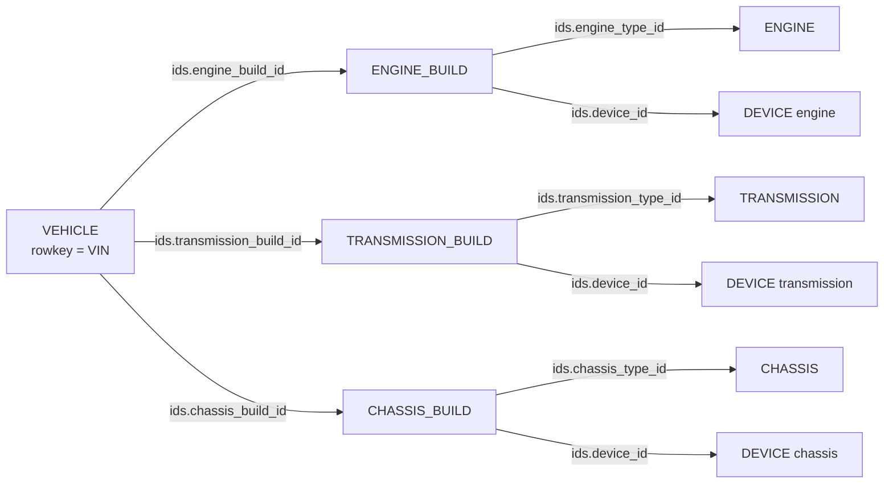

# Vehicle 360 on CDP 7.1.9

Guide for running [`create_vehicle360_tables_cdp.sh`](create_vehicle360_tables_cdp.sh) against **Cloudera Data Platform Private Cloud Base 7.1.9**.

This script is for an **HBase edge/gateway node**. It does **not** use Docker. ZooKeeper, TLS, and security settings come from client configs deployed by Cloudera Manager (default: `/etc/hbase/conf`).

> Script name: `create_vehicle360_tables_cdp.sh`  
> (not `create_vehicle360_tables.cdp.sh`)

## What you must provide

| Input | Flag / env | Required |
|-------|------------|----------|
| HBase binary path | `--hbase-bin` / `HBASE_BIN` | **Yes** (always include in examples) |
| Kerberos principal | `--principal` / `KRB5_PRINCIPAL` | Yes (unless `--skip-kinit`) |
| Kerberos keytab | `--keytab` / `KRB5_KEYTAB` | Yes (unless `--skip-kinit`) |
| Phoenix / PhoenixDotNet API URL | `--api-url` / `API_URL` | Yes (unless `--skip-views` and `--skip-queries`) |
| HBase client conf dir | `--hbase-conf-dir` / `HBASE_CONF_DIR` | Optional (default `/etc/hbase/conf`) |
| Namespace | `--namespace` / `NAMESPACE` | Optional |

Typical CDP HBase path:

```text
/opt/cloudera/parcels/CDH/bin/hbase
```

Also ensure:

- You are logged into a CDP edge node with HBase gateway client configs
- Ranger (or ACLs) allow create/write on the target tables
- `hbase-site.xml` already contains ZooKeeper quorum, znode, and security settings

## Show help

```bash
./create_vehicle360_tables_cdp.sh --help
```

## Example 1: Full setup (HBase + Phoenix views + sample queries)

Creates tables, loads sample data, creates Phoenix views, and runs sample queries.

```bash
./create_vehicle360_tables_cdp.sh \
  --hbase-bin /opt/cloudera/parcels/CDH/bin/hbase \
  --principal user@EXAMPLE.COM \
  --keytab /etc/security/keytabs/user.keytab \
  --api-url https://phoenix-api.example.com/api/phoenix
```

## Example 2: HBase data only (no Phoenix API)

Use when you only need tables and seed data in HBase.

```bash
./create_vehicle360_tables_cdp.sh \
  --hbase-bin /opt/cloudera/parcels/CDH/bin/hbase \
  --principal user@EXAMPLE.COM \
  --keytab /path/to/user.keytab \
  --skip-views \
  --skip-queries
```

## Example 3: Already authenticated (`kinit` done)

```bash
kinit -kt /path/to/user.keytab user@EXAMPLE.COM
klist

./create_vehicle360_tables_cdp.sh \
  --hbase-bin /opt/cloudera/parcels/CDH/bin/hbase \
  --skip-kinit \
  --api-url https://phoenix-api.example.com/api/phoenix
```

## Example 4: Custom HBase conf dir

```bash
./create_vehicle360_tables_cdp.sh \
  --hbase-bin /opt/cloudera/parcels/CDH/bin/hbase \
  --hbase-conf-dir /etc/hbase/conf \
  --principal user@EXAMPLE.COM \
  --keytab /path/to/user.keytab \
  --api-url https://phoenix-api.example.com/api/phoenix
```

## Example 5: Use an HBase namespace

Creates `vehicle360:ENGINE`, `vehicle360:TRANSMISSION`, `vehicle360:CHASSIS`, and `vehicle360:VEHICLE`.

```bash
./create_vehicle360_tables_cdp.sh \
  --hbase-bin /opt/cloudera/parcels/CDH/bin/hbase \
  --principal user@EXAMPLE.COM \
  --keytab /path/to/user.keytab \
  --namespace vehicle360 \
  --api-url https://phoenix-api.example.com/api/phoenix
```

## Example 6: Environment variables instead of flags

```bash
export HBASE_BIN=/opt/cloudera/parcels/CDH/bin/hbase
export KRB5_PRINCIPAL=user@EXAMPLE.COM
export KRB5_KEYTAB=/path/to/user.keytab
export API_URL=https://phoenix-api.example.com/api/phoenix
export HBASE_CONF_DIR=/etc/hbase/conf
export NAMESPACE=vehicle360

./create_vehicle360_tables_cdp.sh \
  --hbase-bin "${HBASE_BIN}"
```

## Example 7: Create data, skip demo queries

```bash
./create_vehicle360_tables_cdp.sh \
  --hbase-bin /opt/cloudera/parcels/CDH/bin/hbase \
  --principal user@EXAMPLE.COM \
  --keytab /path/to/user.keytab \
  --api-url https://phoenix-api.example.com/api/phoenix \
  --skip-queries
```

## Example 8: Verify tables in HBase shell after the script

```bash
kinit -kt /path/to/user.keytab user@EXAMPLE.COM
/opt/cloudera/parcels/CDH/bin/hbase shell
```

```text
list
scan 'VEHICLE', {LIMIT => 2}
get 'ENGINE', 'ENG001'
get 'VEHICLE', '1HGCM82633A004352'
```

If you used a namespace:

```text
list_namespace_tables 'vehicle360'
scan 'vehicle360:VEHICLE', {LIMIT => 2}
```

## Example 9: Complete build sheet via API

After views are created, query VIN → builds → types / devices.

Join path (see also [`README.md`](README.md) architecture diagrams):



```bash
curl -X POST https://phoenix-api.example.com/api/phoenix/query \
  -H "Content-Type: application/json" \
  -d '{
    "sql": "SELECT v.\"rowkey\" as vin, v.\"info\".\"make\", v.\"info\".\"model\", ed.\"specs\".\"name\" as engine_device_name, td.\"specs\".\"name\" as transmission_device_name, cd.\"specs\".\"name\" as chassis_device_name FROM \"VEHICLE\" v JOIN \"ENGINE_BUILD\" eb ON v.\"ids\".\"engine_build_id\" = eb.\"rowkey\" JOIN \"DEVICE\" ed ON eb.\"ids\".\"device_id\" = ed.\"rowkey\" JOIN \"TRANSMISSION_BUILD\" tb ON v.\"ids\".\"transmission_build_id\" = tb.\"rowkey\" JOIN \"DEVICE\" td ON tb.\"ids\".\"device_id\" = td.\"rowkey\" JOIN \"CHASSIS_BUILD\" cb ON v.\"ids\".\"chassis_build_id\" = cb.\"rowkey\" JOIN \"DEVICE\" cd ON cb.\"ids\".\"device_id\" = cd.\"rowkey\" WHERE v.\"rowkey\" = '\''1HGCM82633A004352'\''"
  }'
```

## Options reference

| Option | Description | Default |
|--------|-------------|---------|
| `--hbase-bin PATH` | HBase client binary (**required in examples**) | CDH parcel or `hbase` on `PATH` |
| `--api-url URL` | PhoenixDotNet / Phoenix REST API base | *(none)* |
| `--principal PRINCIPAL` | Kerberos principal for `kinit` | *(none)* |
| `--keytab PATH` | Keytab path for `kinit` | *(none)* |
| `--hbase-conf-dir DIR` | Client conf directory | `/etc/hbase/conf` |
| `--namespace NAME` | Optional HBase namespace | *(default NS)* |
| `--skip-kinit` | Use existing Kerberos ticket | off |
| `--skip-views` | Do not create Phoenix views | off |
| `--skip-queries` | Do not run sample API queries | off |
| `--wait SECONDS` | Pause after create/load | `2` |
| `-h`, `--help` | Show help | |

## Troubleshooting

**`hbase client not found`**  
Pass `--hbase-bin /opt/cloudera/parcels/CDH/bin/hbase`, or install HBase gateway/client on the edge node.

**`HBase conf dir not found`**  
Deploy client configs from Cloudera Manager, or pass `--hbase-conf-dir`.

**Kerberos / `kinit` failures**  
Confirm principal, keytab path, and that `krb5.conf` / KDC are reachable. Try `kinit` manually, then `--skip-kinit`.

**Permission denied creating tables**  
Ask for Ranger (or HBase ACL) rights for the authenticated principal.

**Phoenix view/query failures**  
Confirm `--api-url` is reachable from the edge node and points at your PhoenixDotNet (or compatible) API.

## Related files

- [`create_vehicle360_tables_cdp.sh`](create_vehicle360_tables_cdp.sh) — CDP create/seed script
- [`create_vehicle360_tables.sh`](create_vehicle360_tables.sh) — local Docker script
- [`run_vehicle360_queries.sh`](run_vehicle360_queries.sh) — query examples (local API defaults)
- [`sample_queries.sql`](sample_queries.sql) — Phoenix SQL collection
- [`README.md`](README.md) — Vehicle 360 overview
