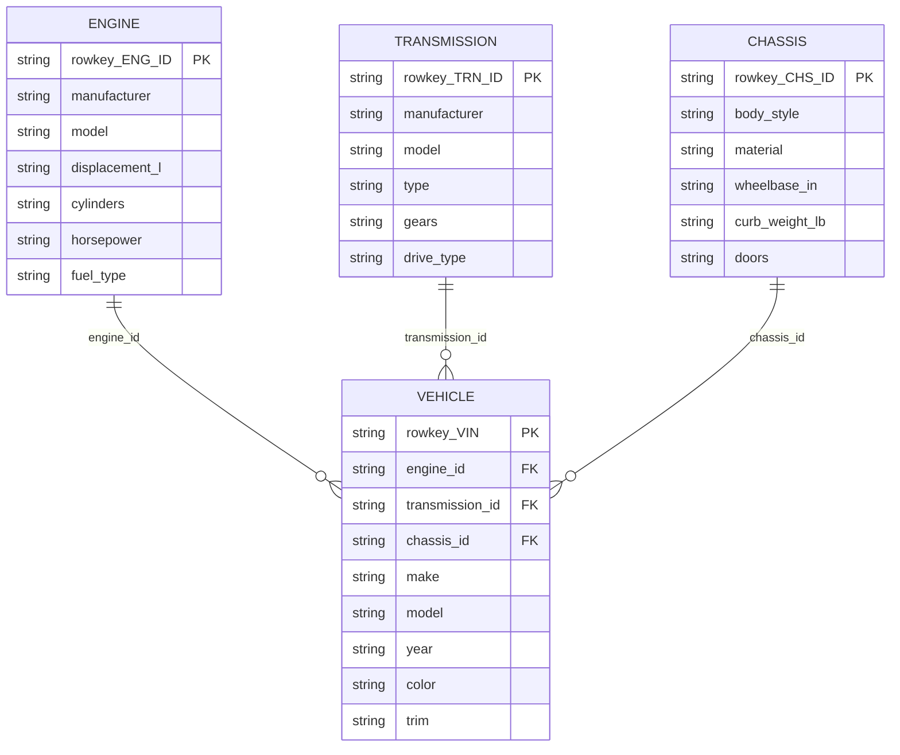
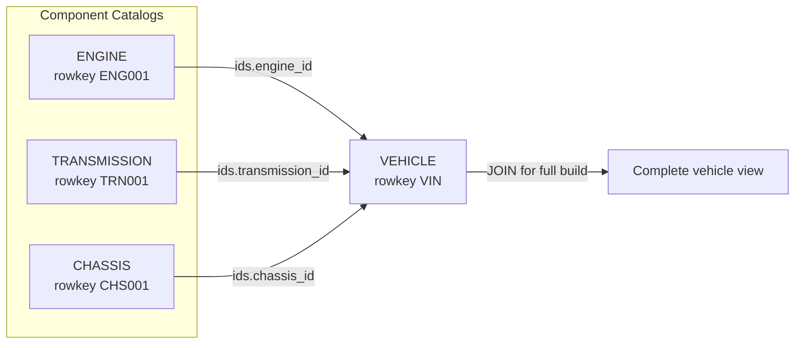

# Vehicle 360 - Use Case

## Overview

This use case demonstrates a **normalized component-catalog + assembly** pattern in HBase with Phoenix SQL access. Unlike the Student 360 and Soldier 360 use cases (single wide table, no JOINs), Vehicle 360 stores engines, transmissions, and chassis in separate catalog tables with their own unique IDs. A `VEHICLE` table keyed by **VIN** (Vehicle Identification Number) references one ID from each catalog.

Full vehicle detail is retrieved with **Phoenix JOINs**.

## Architecture

### Design Approach

Four HBase tables:

| Table | Row Key | Purpose |
|-------|---------|---------|
| `ENGINE` | Engine ID (e.g. `ENG001`) | Engine catalog |
| `TRANSMISSION` | Transmission ID (e.g. `TRN001`) | Transmission catalog |
| `CHASSIS` | Chassis ID (e.g. `CHS001`) | Chassis catalog |
| `VEHICLE` | VIN (e.g. `1HGCM82633A004352`) | Assembled vehicle; stores component ID references |





### Why This Pattern?

Student/Soldier 360 put all attributes in one row for fast single-key lookups. That works when every entity owns its own copy of related data.

Vehicles are different: the same engine or transmission can appear on many VINs. Storing components once and referencing them by ID:

1. Avoids duplicating catalog specs across every vehicle
2. Lets you update a component definition in one place
3. Demonstrates multi-table JOINs in Phoenix over HBase-native tables

### Comparison to 360 Wide-Table Design

| Aspect | Wide Table (Student/Soldier 360) | Vehicle 360 (This Design) |
|--------|----------------------------------|---------------------------|
| Tables | One table | Four tables |
| Row key | Entity ID (student/EDIPI) | Separate IDs + VIN |
| Relationships | Denormalized into one row | FK-style ID references |
| Full profile | `SELECT * WHERE rowkey = ...` | JOINs across tables |
| Reuse | Poor (data copied per row) | Strong (shared components) |
| Best for | Dashboard / complete profile | Catalog + assembly models |

## Table Structure

### ENGINE (`specs`)

Row key: engine ID

| Qualifier | Description |
|-----------|-------------|
| `manufacturer` | Engine manufacturer |
| `model` | Engine model code |
| `displacement_l` | Displacement in liters |
| `cylinders` | Cylinder count |
| `horsepower` | Horsepower |
| `fuel_type` | Gasoline / Electric / etc. |

### TRANSMISSION (`specs`)

Row key: transmission ID

| Qualifier | Description |
|-----------|-------------|
| `manufacturer` | Transmission manufacturer |
| `model` | Transmission model code |
| `type` | Automatic / Manual / CVT |
| `gears` | Gear count (`0` for CVT) |
| `drive_type` | FWD / RWD / AWD |

### CHASSIS (`specs`)

Row key: chassis ID

| Qualifier | Description |
|-----------|-------------|
| `body_style` | Sedan / SUV / Coupe / Hatchback |
| `material` | Steel / Aluminum |
| `wheelbase_in` | Wheelbase in inches |
| `curb_weight_lb` | Curb weight in pounds |
| `doors` | Door count |

### VEHICLE (`ids`, `info`)

Row key: VIN

**Column family `ids`** (component references):

| Qualifier | Description |
|-----------|-------------|
| `engine_id` | References `ENGINE` row key |
| `transmission_id` | References `TRANSMISSION` row key |
| `chassis_id` | References `CHASSIS` row key |

**Column family `info`** (vehicle attributes):

| Qualifier | Description |
|-----------|-------------|
| `make` | Vehicle make |
| `model` | Vehicle model |
| `year` | Model year |
| `color` | Exterior color |
| `trim` | Trim level |

## Sample Data

### Component Catalogs

| Engine ID | Manufacturer | Model | HP | Fuel |
|-----------|--------------|-------|-----|------|
| ENG001 | Honda | K24Z7 | 185 | Gasoline |
| ENG002 | Toyota | 2GR-FE | 268 | Gasoline |
| ENG003 | Ford | EcoBoost 2.3 | 310 | Gasoline |
| ENG004 | BMW | B58B30 | 382 | Gasoline |
| ENG005 | Tesla | Dual Motor | 670 | Electric |

| Transmission ID | Type | Drive |
|-----------------|------|-------|
| TRN001 | CVT | FWD |
| TRN002 | Automatic (6) | AWD |
| TRN003 | Manual (6) | RWD |
| TRN004 | Automatic (8) | RWD |

| Chassis ID | Body Style | Doors |
|------------|------------|-------|
| CHS001 | Sedan | 4 |
| CHS002 | SUV | 4 |
| CHS003 | Coupe | 2 |
| CHS004 | Hatchback | 4 |

### Vehicles (component reuse)

| VIN | Make / Model | Engine | Trans | Chassis |
|-----|--------------|--------|-------|---------|
| 1HGCM82633A004352 | Honda Civic 2022 | ENG001 | TRN001 | CHS001 |
| 1HGCV1F30JA000123 | Honda Accord 2023 | ENG001 | TRN001 | CHS001 |
| 5TDKZRFH0KS123456 | Toyota Highlander 2021 | ENG002 | TRN002 | CHS002 |
| 2T3P1RFV8MW078901 | Toyota RAV4 2024 | ENG002 | TRN002 | CHS002 |
| 1FA6P8CF5L5102345 | Ford Mustang 2020 | ENG003 | TRN003 | CHS003 |
| WBA5U9C05LF345678 | BMW M340i 2023 | ENG004 | TRN004 | CHS001 |
| 5YJ3E1EA1KF789012 | Tesla Model Y 2024 | ENG005 | TRN004 | CHS004 |

Note that ENG001/TRN001/CHS001 and ENG002/TRN002/CHS002 are shared across multiple VINs.

## Implementation

### Script Location

- `create_vehicle360_tables.sh` - Local Docker / docker-compose stack
- `create_vehicle360_tables_cdp.sh` - **CDP Private Cloud Base 7.1.9** (edge node + Kerberos; no Docker)
- [`CDP.md`](CDP.md) - CDP 7.1.9 usage examples for `create_vehicle360_tables_cdp.sh`
- `run_vehicle360_queries.sh` - Runs query examples (including complete vehicle JOIN view)
- `sample_queries.sql` - Full collection of Phoenix SQL queries

### Quick Start

1. **Create tables, data, and views** (local Docker):
   ```bash
   ./create_vehicle360_tables.sh
   ```

   Optional overrides (defaults match local docker-compose):
   ```bash
   ./create_vehicle360_tables.sh --help
   ./create_vehicle360_tables.sh \
     --api-url http://localhost:8099/api/phoenix \
     --container opdb-docker \
     --hbase-bin /opt/hbase/bin/hbase
   ```

2. **Create tables on CDP 7.1.9** (run on an HBase edge/gateway node):
   ```bash
   ./create_vehicle360_tables_cdp.sh --help
   ./create_vehicle360_tables_cdp.sh \
     --hbase-bin /opt/cloudera/parcels/CDH/bin/hbase \
     --principal user@EXAMPLE.COM \
     --keytab /path/to/user.keytab \
     --api-url https://your-phoenix-api.example.com/api/phoenix
   ```

   User must provide Kerberos principal/keytab (or `--skip-kinit`), and an `--api-url` unless skipping views/queries. ZooKeeper and security settings come from Cloudera Manager client configs (`--hbase-conf-dir`, default `/etc/hbase/conf`).

3. **Use the SQL Search GUI** (http://localhost:8100):
   - Open the **Vehicle 360** section
   - Create Phoenix views (Execute Command), then run VIN / JOIN queries (Execute Query)

4. **Or run query examples from the CLI**:
   ```bash
   ./run_vehicle360_queries.sh
   ```

5. **Or query a full vehicle build manually**:
   ```bash
   curl -X POST http://localhost:8099/api/phoenix/query \
     -H "Content-Type: application/json" \
     -d '{"sql": "SELECT v.\"rowkey\" as vin, v.\"info\".\"make\", v.\"info\".\"model\", e.\"specs\".\"horsepower\", t.\"specs\".\"type\", c.\"specs\".\"body_style\" FROM \"VEHICLE\" v JOIN \"ENGINE\" e ON v.\"ids\".\"engine_id\" = e.\"rowkey\" JOIN \"TRANSMISSION\" t ON v.\"ids\".\"transmission_id\" = t.\"rowkey\" JOIN \"CHASSIS\" c ON v.\"ids\".\"chassis_id\" = c.\"rowkey\" WHERE v.\"rowkey\" = '\''1HGCM82633A004352'\''"}'
   ```

> **Important**: HBase tables and Phoenix views are **ephemeral** in the Docker container. If you stop or restart the Docker environment (`docker-compose down`), recreate them:
> ```bash
> ./create_vehicle360_tables.sh
> ```

### Manual Setup

#### Step 1: Create HBase Tables

```bash
docker exec -i opdb-docker /opt/hbase/bin/hbase shell <<'EOF'
create 'ENGINE', 'specs'
create 'TRANSMISSION', 'specs'
create 'CHASSIS', 'specs'
create 'VEHICLE', 'ids', 'info'
EOF
```

#### Step 2: Insert Sample Data

```bash
docker exec -i opdb-docker /opt/hbase/bin/hbase shell <<'EOF'
put 'ENGINE', 'ENG001', 'specs:manufacturer', 'Honda'
put 'ENGINE', 'ENG001', 'specs:model', 'K24Z7'
put 'ENGINE', 'ENG001', 'specs:horsepower', '185'
put 'TRANSMISSION', 'TRN001', 'specs:type', 'CVT'
put 'TRANSMISSION', 'TRN001', 'specs:drive_type', 'FWD'
put 'CHASSIS', 'CHS001', 'specs:body_style', 'Sedan'
put 'VEHICLE', '1HGCM82633A004352', 'ids:engine_id', 'ENG001'
put 'VEHICLE', '1HGCM82633A004352', 'ids:transmission_id', 'TRN001'
put 'VEHICLE', '1HGCM82633A004352', 'ids:chassis_id', 'CHS001'
put 'VEHICLE', '1HGCM82633A004352', 'info:make', 'Honda'
put 'VEHICLE', '1HGCM82633A004352', 'info:model', 'Civic'
put 'VEHICLE', '1HGCM82633A004352', 'info:year', '2022'
EOF
```

#### Step 3: Create Phoenix Views

```bash
curl -X POST http://localhost:8099/api/phoenix/execute \
  -H "Content-Type: application/json" \
  -d '{"sql": "CREATE VIEW IF NOT EXISTS \"ENGINE\" (\"rowkey\" VARCHAR PRIMARY KEY, \"specs\".\"manufacturer\" VARCHAR, \"specs\".\"model\" VARCHAR, \"specs\".\"displacement_l\" VARCHAR, \"specs\".\"cylinders\" VARCHAR, \"specs\".\"horsepower\" VARCHAR, \"specs\".\"fuel_type\" VARCHAR)"}'

curl -X POST http://localhost:8099/api/phoenix/execute \
  -H "Content-Type: application/json" \
  -d '{"sql": "CREATE VIEW IF NOT EXISTS \"TRANSMISSION\" (\"rowkey\" VARCHAR PRIMARY KEY, \"specs\".\"manufacturer\" VARCHAR, \"specs\".\"model\" VARCHAR, \"specs\".\"type\" VARCHAR, \"specs\".\"gears\" VARCHAR, \"specs\".\"drive_type\" VARCHAR)"}'

curl -X POST http://localhost:8099/api/phoenix/execute \
  -H "Content-Type: application/json" \
  -d '{"sql": "CREATE VIEW IF NOT EXISTS \"CHASSIS\" (\"rowkey\" VARCHAR PRIMARY KEY, \"specs\".\"body_style\" VARCHAR, \"specs\".\"material\" VARCHAR, \"specs\".\"wheelbase_in\" VARCHAR, \"specs\".\"curb_weight_lb\" VARCHAR, \"specs\".\"doors\" VARCHAR)"}'

curl -X POST http://localhost:8099/api/phoenix/execute \
  -H "Content-Type: application/json" \
  -d '{"sql": "CREATE VIEW IF NOT EXISTS \"VEHICLE\" (\"rowkey\" VARCHAR PRIMARY KEY, \"ids\".\"engine_id\" VARCHAR, \"ids\".\"transmission_id\" VARCHAR, \"ids\".\"chassis_id\" VARCHAR, \"info\".\"make\" VARCHAR, \"info\".\"model\" VARCHAR, \"info\".\"year\" VARCHAR, \"info\".\"color\" VARCHAR, \"info\".\"trim\" VARCHAR)"}'
```

## Query Examples

### Query 1: Vehicle by VIN (IDs only)

```sql
SELECT
  "rowkey" as vin,
  "info"."make",
  "info"."model",
  "info"."year",
  "ids"."engine_id",
  "ids"."transmission_id",
  "ids"."chassis_id"
FROM "VEHICLE"
WHERE "rowkey" = '1HGCM82633A004352'
```

### Query 2: Full Vehicle Build (JOINs)

```sql
SELECT
  v."rowkey" as vin,
  v."info"."make",
  v."info"."model",
  v."info"."year",
  e."specs"."horsepower",
  t."specs"."type",
  t."specs"."drive_type",
  c."specs"."body_style"
FROM "VEHICLE" v
JOIN "ENGINE" e ON v."ids"."engine_id" = e."rowkey"
JOIN "TRANSMISSION" t ON v."ids"."transmission_id" = t."rowkey"
JOIN "CHASSIS" c ON v."ids"."chassis_id" = c."rowkey"
WHERE v."rowkey" = '1HGCM82633A004352'
```

### Query 3: Vehicles Sharing an Engine

```sql
SELECT
  "rowkey" as vin,
  "info"."make",
  "info"."model",
  "info"."year",
  "ids"."engine_id"
FROM "VEHICLE"
WHERE "ids"."engine_id" = 'ENG001'
ORDER BY "rowkey"
```

### Query 4: High-Horsepower Vehicles

```sql
SELECT
  v."rowkey" as vin,
  v."info"."make",
  v."info"."model",
  e."specs"."horsepower"
FROM "VEHICLE" v
JOIN "ENGINE" e ON v."ids"."engine_id" = e."rowkey"
WHERE TO_NUMBER(e."specs"."horsepower") >= 300
ORDER BY TO_NUMBER(e."specs"."horsepower") DESC
```

### Query 5: Count Vehicles per Transmission Type

```sql
SELECT
  t."specs"."type" as transmission_type,
  COUNT(*) as vehicle_count
FROM "VEHICLE" v
JOIN "TRANSMISSION" t ON v."ids"."transmission_id" = t."rowkey"
GROUP BY t."specs"."type"
ORDER BY t."specs"."type"
```

## Key Design Decisions

### Row Keys

- **Component tables**: Short unique IDs (`ENG001`, `TRN001`, `CHS001`) for easy reference from `VEHICLE`
- **VEHICLE**: VIN as row key — natural unique identifier for a finished vehicle
- All keys stored as VARCHAR strings

### Column Families

- Component tables use a single `specs` family (all attributes accessed together)
- `VEHICLE` separates `ids` (references) from `info` (vehicle attributes) so you can fetch just the assembly links or just the display fields

### Data Types

- All HBase values are VARCHAR
- Use `TO_NUMBER()` for numeric comparisons in Phoenix (e.g. horsepower, year, weight)
- HBase does not enforce foreign keys; application/query logic must join on matching ID strings

### Scalability

- Component catalogs stay small and are reused across many vehicles
- Vehicle table grows with fleet size; row-key VIN lookups remain O(1)
- JOIN cost appears only when a full build is needed

## Use Cases

### 1. VIN Lookup Dashboard

Show make/model plus full component specs for a single VIN (Query 2 above).

### 2. Parts Reuse Report

Find every vehicle built with a given engine or transmission (Query 3).

### 3. Performance Filtering

Filter the fleet by horsepower, drivetrain, or body style via JOINs.

### 4. Catalog Maintenance

Update engine horsepower once in `ENGINE`; all vehicles referencing that ID see the new value on the next JOIN query.

## Related Documentation

- [Student 360 Use Case](../student360/README.md) — single wide-table pattern
- [Soldier 360 Use Case](../soldier360/README.md) — single wide-table pattern
- [Student 360 Multi-Table Design](../student360/student_360_view_design.md) — alternate JOIN design with shared row keys
- [Phoenix Views Documentation](../../Documentation/README_VIEWS.md)
- [HBase vs Phoenix Tables](../../Documentation/HBASE_VS_PHOENIX_TABLES.md)

## Sample SQL Queries

See `sample_queries.sql` for 30+ queries covering:

- Component lookups by ID
- Vehicle lookups by VIN / make / year
- Full vehicle builds with JOINs
- Component reuse and counts
- Filters with `TO_NUMBER()`
- Aggregations by make, transmission type, body style, fuel type

## Summary

The Vehicle 360 use case demonstrates:

- Separate HBase tables for engine, transmission, and chassis catalogs
- Unique IDs per component row
- A VIN-keyed `VEHICLE` table that combines one engine ID, one transmission ID, and one chassis ID
- Phoenix views for SQL access
- JOIN-based full vehicle builds
- A clear contrast to the denormalized student/soldier 360 wide-table pattern
