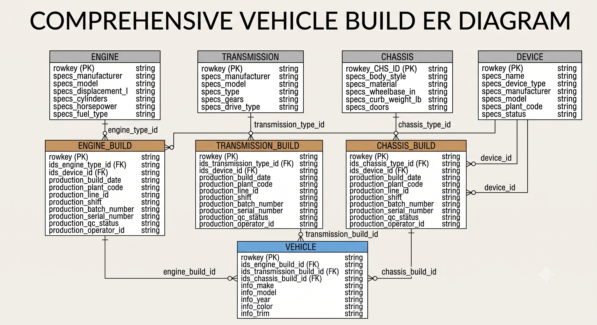
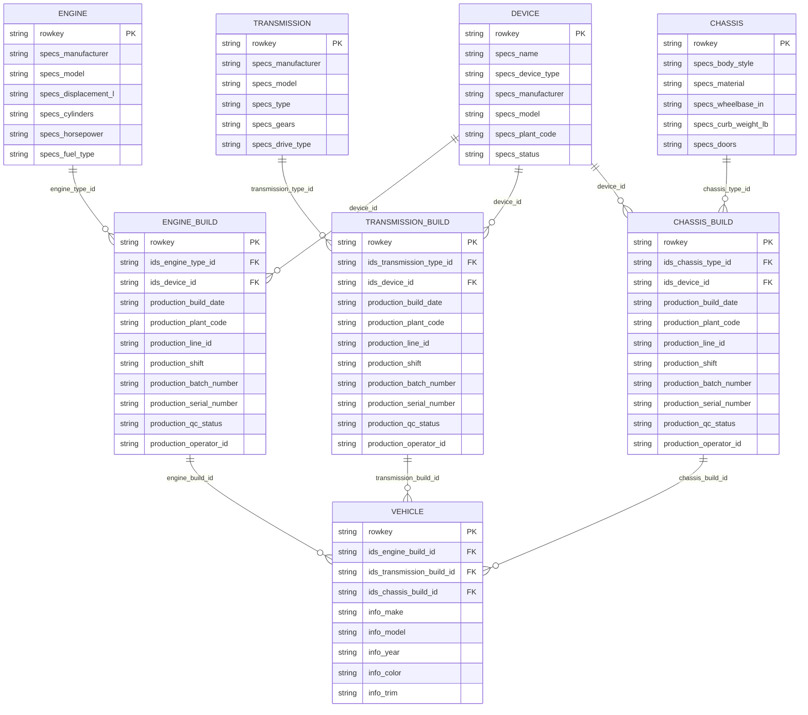
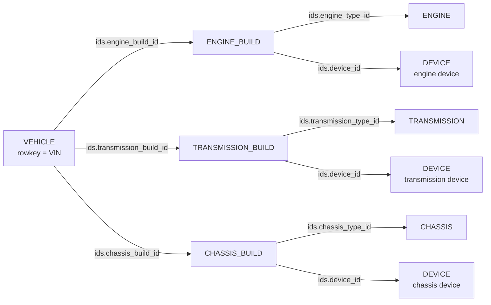
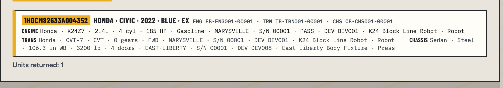

# Vehicle 360 - Use Case

## Overview

This use case demonstrates a **type catalog → manufacturing device → physical build → VIN assembly** pattern in HBase with Phoenix SQL access. Unlike Student/Soldier 360 (single wide table, no JOINs), Vehicle 360 separates:

1. **Type catalogs** — reusable component definitions (`ENG001`, `TRN001`, `CHS001`)
2. **DEVICE** — shared manufacturing equipment catalog (`DEV001`, …)
3. **Build tables** — individual manufactured units with production metadata + `device_id`
4. **VEHICLE** — VIN row that references **build IDs** (not type IDs)

Full vehicle detail is retrieved with **Phoenix JOINs**: `VEHICLE → *_BUILD → type catalog` and `*_BUILD → DEVICE`.

## Architecture

### Design Approach

Eight HBase tables:

| Table | Row Key | Purpose |
|-------|---------|---------|
| `ENGINE` | Type ID (e.g. `ENG001`) | Engine type catalog |
| `TRANSMISSION` | Type ID (e.g. `TRN001`) | Transmission type catalog |
| `CHASSIS` | Type ID (e.g. `CHS001`) | Chassis type catalog |
| `DEVICE` | Device ID (e.g. `DEV001`) | Manufacturing equipment catalog |
| `ENGINE_BUILD` | Build ID (e.g. `EB-ENG001-00001`) | Physical engine + production + device |
| `TRANSMISSION_BUILD` | Build ID (e.g. `TB-TRN001-00001`) | Physical transmission + production + device |
| `CHASSIS_BUILD` | Build ID (e.g. `CB-CHS001-00001`) | Physical chassis + production + device |
| `VEHICLE` | VIN | Assembled vehicle; stores `*_build_id` refs |

#### Table relationships (all fields)



Attribute names use `family_qualifier` (HBase `family:qualifier`). Mermaid equivalent of the diagram above:



#### Full vehicle JOIN path

One VIN fans out to three builds; each build joins its type catalog and the shared `DEVICE` table (`ed` / `td` / `cd` are aliases).



### Why This Pattern?

Student/Soldier 360 put all attributes in one row for fast single-key lookups. Vehicles need both shared type definitions and per-unit manufacturing history:

1. Type catalogs avoid duplicating specs across every unit
2. Build rows capture plant, line, shift, batch, serial, QC, operator
3. VIN → build IDs tracks the exact physical parts on a vehicle
4. Demonstrates multi-hop JOINs in Phoenix over HBase-native tables

### Comparison to 360 Wide-Table Design

| Aspect | Wide Table (Student/Soldier 360) | Vehicle 360 (This Design) |
|--------|----------------------------------|---------------------------|
| Tables | One table | Eight tables (3 types + DEVICE + 3 builds + VIN) |
| Row key | Entity ID (student/EDIPI) | Type IDs, build IDs, VIN |
| Relationships | Denormalized into one row | Type → build → VIN |
| Full profile | `SELECT * WHERE rowkey = ...` | JOINs through builds |
| Reuse | Poor (data copied per row) | Strong (shared types; unique builds) |
| Best for | Dashboard / complete profile | Catalog + manufacturing + assembly |

## Table Structure

### ENGINE (`specs`)

Row key: engine ID

| Qualifier | Description |
|-----------|-------------|
| `manufacturer` | Engine manufacturer |
| `model` | Engine model code |
| `displacement_l` | Displacement in liters |
| `cylinders` | Cylinder count |
| `horsepower` | Horsepower |
| `fuel_type` | Gasoline / Electric / etc. |

### TRANSMISSION (`specs`)

Row key: transmission ID

| Qualifier | Description |
|-----------|-------------|
| `manufacturer` | Transmission manufacturer |
| `model` | Transmission model code |
| `type` | Automatic / Manual / CVT |
| `gears` | Gear count (`0` for CVT) |
| `drive_type` | FWD / RWD / AWD |

### CHASSIS (`specs`)

Row key: chassis ID

| Qualifier | Description |
|-----------|-------------|
| `body_style` | Sedan / SUV / Coupe / Hatchback |
| `material` | Steel / Aluminum |
| `wheelbase_in` | Wheelbase in inches |
| `curb_weight_lb` | Curb weight in pounds |
| `doors` | Door count |

### DEVICE (`specs`)

Row key: device ID (`DEV001`, …)

| Qualifier | Description |
|-----------|-------------|
| `name` | Human-readable device label |
| `device_type` | Robot / CNC / Press / TorqueStation / TestCell |
| `manufacturer` | Equipment OEM |
| `model` | Equipment model |
| `plant_code` | Home plant |
| `status` | ACTIVE / MAINTENANCE |

### ENGINE_BUILD / TRANSMISSION_BUILD / CHASSIS_BUILD (`ids`, `production`)

Row key: build ID (`EB-…`, `TB-…`, `CB-…`)

**Column family `ids`**:

| Qualifier | Table | Description |
|-----------|-------|-------------|
| `engine_type_id` | `ENGINE_BUILD` | References `ENGINE` |
| `transmission_type_id` | `TRANSMISSION_BUILD` | References `TRANSMISSION` |
| `chassis_type_id` | `CHASSIS_BUILD` | References `CHASSIS` |
| `device_id` | all build tables | References shared `DEVICE` |

**Column family `production`** (all three build tables):

| Qualifier | Description |
|-----------|-------------|
| `build_date` | Manufacture date |
| `plant_code` | Plant |
| `line_id` | Line |
| `shift` | Shift |
| `batch_number` | Batch |
| `serial_number` | Unit serial |
| `qc_status` | QC result |
| `operator_id` | Operator |

### VEHICLE (`ids`, `info`)

Row key: VIN

**Column family `ids`** (physical build references):

| Qualifier | Description |
|-----------|-------------|
| `engine_build_id` | References `ENGINE_BUILD` |
| `transmission_build_id` | References `TRANSMISSION_BUILD` |
| `chassis_build_id` | References `CHASSIS_BUILD` |

**Column family `info`**: `make`, `model`, `year`, `color`, `trim`

## Sample Data

### Type catalogs

| Engine ID | Manufacturer | Model | HP | Fuel |
|-----------|--------------|-------|-----|------|
| ENG001 | Honda | K24Z7 | 185 | Gasoline |
| ENG002 | Toyota | 2GR-FE | 268 | Gasoline |
| ENG003 | Ford | EcoBoost 2.3 | 310 | Gasoline |
| ENG004 | BMW | B58B30 | 382 | Gasoline |
| ENG005 | Tesla | Dual Motor | 670 | Electric |

Types `TRN001`–`TRN004` and `CHS001`–`CHS004` are unchanged from the original catalogs.

### Vehicles (VIN → build IDs)

| VIN | Make / Model | Engine build | Trans build | Chassis build |
|-----|--------------|--------------|-------------|----------------|
| 1HGCM82633A004352 | Honda Civic 2022 | EB-ENG001-00001 | TB-TRN001-00001 | CB-CHS001-00001 |
| 1HGCV1F30JA000123 | Honda Accord 2023 | EB-ENG001-00002 | TB-TRN001-00002 | CB-CHS001-00002 |
| 5TDKZRFH0KS123456 | Toyota Highlander 2021 | EB-ENG002-00001 | TB-TRN002-00001 | CB-CHS002-00001 |
| 2T3P1RFV8MW078901 | Toyota RAV4 2024 | EB-ENG002-00002 | TB-TRN002-00002 | CB-CHS002-00002 |
| 1FA6P8CF5L5102345 | Ford Mustang 2020 | EB-ENG003-00001 | TB-TRN003-00001 | CB-CHS003-00001 |
| WBA5U9C05LF345678 | BMW M340i 2023 | EB-ENG004-00001 | TB-TRN004-00001 | CB-CHS001-00003 |
| 5YJ3E1EA1KF789012 | Tesla Model Y 2024 | EB-ENG005-00001 | TB-TRN004-00002 | CB-CHS004-00001 |

Multiple VINs can share an engine **type** (e.g. ENG001) while each gets a distinct **build** row.

## Implementation

### Script Location

- `create_vehicle360_tables.sh` - Local Docker / docker-compose stack
- `create_vehicle360_tables_cdp.sh` - **CDP Private Cloud Base 7.1.9** (edge node + Kerberos; no Docker)
- [`CDP.md`](CDP.md) - CDP 7.1.9 usage examples for `create_vehicle360_tables_cdp.sh`
- `run_vehicle360_queries.sh` - Runs query examples (including complete vehicle JOIN view)
- `sample_queries.sql` - Full collection of Phoenix SQL queries

### Quick Start

1. **Create tables, data, and views** (local Docker):
   ```bash
   ./create_vehicle360_tables.sh
   ```

   Optional overrides (defaults match local docker-compose):
   ```bash
   ./create_vehicle360_tables.sh --help
   ./create_vehicle360_tables.sh \
     --api-url http://localhost:8099/api/phoenix \
     --container opdb-docker \
     --hbase-bin /opt/hbase/bin/hbase
   ```

2. **Create tables on CDP 7.1.9** (run on an HBase edge/gateway node):
   ```bash
   ./create_vehicle360_tables_cdp.sh --help
   ./create_vehicle360_tables_cdp.sh \
     --hbase-bin /opt/cloudera/parcels/CDH/bin/hbase \
     --principal user@EXAMPLE.COM \
     --keytab /path/to/user.keytab \
     --api-url https://your-phoenix-api.example.com/api/phoenix
   ```

   User must provide Kerberos principal/keytab (or `--skip-kinit`), and an `--api-url` unless skipping views/queries. ZooKeeper and security settings come from Cloudera Manager client configs (`--hbase-conf-dir`, default `/etc/hbase/conf`).

3. **Use the SQL Search GUI** (http://localhost:8100):
   - Open the **Vehicle 360** section
   - Create Phoenix views (Execute Command), then run VIN / JOIN queries (Execute Query)

4. **Or run query examples from the CLI**:
   ```bash
   ./run_vehicle360_queries.sh
   ```

5. **Or query a full vehicle build manually**:
   ```bash
   curl -X POST http://localhost:8099/api/phoenix/query \
     -H "Content-Type: application/json" \
     -d '{"sql": "SELECT v.\"rowkey\" as vin, v.\"info\".\"make\", v.\"info\".\"model\", eb.\"rowkey\" as engine_build_id, e.\"specs\".\"horsepower\", ed.\"specs\".\"name\" as engine_device_name, tb.\"rowkey\" as transmission_build_id, t.\"specs\".\"type\", td.\"specs\".\"name\" as transmission_device_name, cb.\"rowkey\" as chassis_build_id, c.\"specs\".\"body_style\", cd.\"specs\".\"name\" as chassis_device_name FROM \"VEHICLE\" v JOIN \"ENGINE_BUILD\" eb ON v.\"ids\".\"engine_build_id\" = eb.\"rowkey\" JOIN \"ENGINE\" e ON eb.\"ids\".\"engine_type_id\" = e.\"rowkey\" JOIN \"DEVICE\" ed ON eb.\"ids\".\"device_id\" = ed.\"rowkey\" JOIN \"TRANSMISSION_BUILD\" tb ON v.\"ids\".\"transmission_build_id\" = tb.\"rowkey\" JOIN \"TRANSMISSION\" t ON tb.\"ids\".\"transmission_type_id\" = t.\"rowkey\" JOIN \"DEVICE\" td ON tb.\"ids\".\"device_id\" = td.\"rowkey\" JOIN \"CHASSIS_BUILD\" cb ON v.\"ids\".\"chassis_build_id\" = cb.\"rowkey\" JOIN \"CHASSIS\" c ON cb.\"ids\".\"chassis_type_id\" = c.\"rowkey\" JOIN \"DEVICE\" cd ON cb.\"ids\".\"device_id\" = cd.\"rowkey\" WHERE v.\"rowkey\" = '\''1HGCM82633A004352'\''"}'
   ```

> **Important**: HBase tables and Phoenix views are **ephemeral** in the Docker container. If you stop or restart the Docker environment (`docker-compose down`), recreate them:
> ```bash
> ./create_vehicle360_tables.sh --recreate
> ```

### Manual Setup

Prefer `./create_vehicle360_tables.sh --recreate`. Minimal skeleton:

#### Step 1: Create HBase Tables

```bash
docker exec -i opdb-docker /opt/hbase/bin/hbase shell <<'EOF'
create 'ENGINE', 'specs'
create 'TRANSMISSION', 'specs'
create 'CHASSIS', 'specs'
create 'ENGINE_BUILD', 'ids', 'production'
create 'TRANSMISSION_BUILD', 'ids', 'production'
create 'CHASSIS_BUILD', 'ids', 'production'
create 'VEHICLE', 'ids', 'info'
EOF
```

#### Step 2: Insert Sample Data

```bash
docker exec -i opdb-docker /opt/hbase/bin/hbase shell <<'EOF'
put 'ENGINE', 'ENG001', 'specs:manufacturer', 'Honda'
put 'ENGINE', 'ENG001', 'specs:model', 'K24Z7'
put 'ENGINE', 'ENG001', 'specs:horsepower', '185'
put 'ENGINE_BUILD', 'EB-ENG001-00001', 'ids:engine_type_id', 'ENG001'
put 'ENGINE_BUILD', 'EB-ENG001-00001', 'production:plant_code', 'MARYSVILLE'
put 'ENGINE_BUILD', 'EB-ENG001-00001', 'production:serial_number', '00001'
put 'TRANSMISSION', 'TRN001', 'specs:type', 'CVT'
put 'TRANSMISSION_BUILD', 'TB-TRN001-00001', 'ids:transmission_type_id', 'TRN001'
put 'CHASSIS', 'CHS001', 'specs:body_style', 'Sedan'
put 'CHASSIS_BUILD', 'CB-CHS001-00001', 'ids:chassis_type_id', 'CHS001'
put 'VEHICLE', '1HGCM82633A004352', 'ids:engine_build_id', 'EB-ENG001-00001'
put 'VEHICLE', '1HGCM82633A004352', 'ids:transmission_build_id', 'TB-TRN001-00001'
put 'VEHICLE', '1HGCM82633A004352', 'ids:chassis_build_id', 'CB-CHS001-00001'
put 'VEHICLE', '1HGCM82633A004352', 'info:make', 'Honda'
put 'VEHICLE', '1HGCM82633A004352', 'info:model', 'Civic'
put 'VEHICLE', '1HGCM82633A004352', 'info:year', '2022'
EOF
```

#### Step 3: Create Phoenix Views

```bash
curl -X POST http://localhost:8099/api/phoenix/execute \
  -H "Content-Type: application/json" \
  -d '{"sql": "CREATE VIEW IF NOT EXISTS \"ENGINE\" (\"rowkey\" VARCHAR PRIMARY KEY, \"specs\".\"manufacturer\" VARCHAR, \"specs\".\"model\" VARCHAR, \"specs\".\"displacement_l\" VARCHAR, \"specs\".\"cylinders\" VARCHAR, \"specs\".\"horsepower\" VARCHAR, \"specs\".\"fuel_type\" VARCHAR)"}'

curl -X POST http://localhost:8099/api/phoenix/execute \
  -H "Content-Type: application/json" \
  -d '{"sql": "CREATE VIEW IF NOT EXISTS \"TRANSMISSION\" (\"rowkey\" VARCHAR PRIMARY KEY, \"specs\".\"manufacturer\" VARCHAR, \"specs\".\"model\" VARCHAR, \"specs\".\"type\" VARCHAR, \"specs\".\"gears\" VARCHAR, \"specs\".\"drive_type\" VARCHAR)"}'

curl -X POST http://localhost:8099/api/phoenix/execute \
  -H "Content-Type: application/json" \
  -d '{"sql": "CREATE VIEW IF NOT EXISTS \"CHASSIS\" (\"rowkey\" VARCHAR PRIMARY KEY, \"specs\".\"body_style\" VARCHAR, \"specs\".\"material\" VARCHAR, \"specs\".\"wheelbase_in\" VARCHAR, \"specs\".\"curb_weight_lb\" VARCHAR, \"specs\".\"doors\" VARCHAR)"}'

curl -X POST http://localhost:8099/api/phoenix/execute \
  -H "Content-Type: application/json" \
  -d '{"sql": "CREATE VIEW IF NOT EXISTS \"VEHICLE\" (\"rowkey\" VARCHAR PRIMARY KEY, \"ids\".\"engine_build_id\" VARCHAR, \"ids\".\"transmission_build_id\" VARCHAR, \"ids\".\"chassis_build_id\" VARCHAR, \"info\".\"make\" VARCHAR, \"info\".\"model\" VARCHAR, \"info\".\"year\" VARCHAR, \"info\".\"color\" VARCHAR, \"info\".\"trim\" VARCHAR)"}'
```

Also create `DEVICE`, `ENGINE_BUILD`, `TRANSMISSION_BUILD`, and `CHASSIS_BUILD` views (see `sample_queries.sql`).

## Query Examples

### Query 1: Vehicle by VIN (build IDs only)

```sql
SELECT
  "rowkey" as vin,
  "info"."make",
  "info"."model",
  "info"."year",
  "ids"."engine_build_id",
  "ids"."transmission_build_id",
  "ids"."chassis_build_id"
FROM "VEHICLE"
WHERE "rowkey" = '1HGCM82633A004352'
```

### Query 2: Full build sheet (VIN → builds → types / devices)

```sql
SELECT
  v."rowkey" as vin,
  v."info"."make",
  v."info"."model",
  v."info"."year",
  eb."rowkey" as engine_build_id,
  eb."production"."plant_code" as engine_plant,
  e."specs"."horsepower",
  ed."rowkey" as engine_device_id,
  ed."specs"."name" as engine_device_name,
  tb."rowkey" as transmission_build_id,
  t."specs"."type",
  t."specs"."drive_type",
  td."rowkey" as transmission_device_id,
  td."specs"."name" as transmission_device_name,
  cb."rowkey" as chassis_build_id,
  c."specs"."body_style",
  cd."rowkey" as chassis_device_id,
  cd."specs"."name" as chassis_device_name
FROM "VEHICLE" v
JOIN "ENGINE_BUILD" eb ON v."ids"."engine_build_id" = eb."rowkey"
JOIN "ENGINE" e ON eb."ids"."engine_type_id" = e."rowkey"
JOIN "DEVICE" ed ON eb."ids"."device_id" = ed."rowkey"
JOIN "TRANSMISSION_BUILD" tb ON v."ids"."transmission_build_id" = tb."rowkey"
JOIN "TRANSMISSION" t ON tb."ids"."transmission_type_id" = t."rowkey"
JOIN "DEVICE" td ON tb."ids"."device_id" = td."rowkey"
JOIN "CHASSIS_BUILD" cb ON v."ids"."chassis_build_id" = cb."rowkey"
JOIN "CHASSIS" c ON cb."ids"."chassis_type_id" = c."rowkey"
JOIN "DEVICE" cd ON cb."ids"."device_id" = cd."rowkey"
WHERE v."rowkey" = '1HGCM82633A004352'
```

See [Example Screenshots](#example-screenshots) for the Garage Bay build-sheet result for this VIN.

### Query 3: Vehicles sharing an engine type (via builds)

```sql
SELECT
  v."rowkey" as vin,
  v."info"."make",
  v."info"."model",
  eb."rowkey" as engine_build_id,
  eb."ids"."engine_type_id"
FROM "VEHICLE" v
JOIN "ENGINE_BUILD" eb ON v."ids"."engine_build_id" = eb."rowkey"
WHERE eb."ids"."engine_type_id" = 'ENG001'
ORDER BY v."rowkey"
```

### Query 4: VINs that used the same device

A manufacturing device can appear on engine, transmission, and/or chassis builds. Union the three paths to list every VIN that touched a given `device_id` (example: `DEV008` — East Liberty Body Fixture on Civic and Accord chassis).

```sql
SELECT
  v."rowkey" as vin,
  v."info"."make" as make,
  v."info"."model" as model,
  v."info"."year" as year,
  'ENGINE' as build_role,
  eb."rowkey" as build_id,
  eb."ids"."device_id" as device_id,
  d."specs"."name" as device_name,
  d."specs"."device_type" as device_type
FROM "VEHICLE" v
JOIN "ENGINE_BUILD" eb ON v."ids"."engine_build_id" = eb."rowkey"
JOIN "DEVICE" d ON eb."ids"."device_id" = d."rowkey"
WHERE eb."ids"."device_id" = 'DEV008'
UNION ALL
SELECT
  v."rowkey" as vin,
  v."info"."make" as make,
  v."info"."model" as model,
  v."info"."year" as year,
  'TRANSMISSION' as build_role,
  tb."rowkey" as build_id,
  tb."ids"."device_id" as device_id,
  d."specs"."name" as device_name,
  d."specs"."device_type" as device_type
FROM "VEHICLE" v
JOIN "TRANSMISSION_BUILD" tb ON v."ids"."transmission_build_id" = tb."rowkey"
JOIN "DEVICE" d ON tb."ids"."device_id" = d."rowkey"
WHERE tb."ids"."device_id" = 'DEV008'
UNION ALL
SELECT
  v."rowkey" as vin,
  v."info"."make" as make,
  v."info"."model" as model,
  v."info"."year" as year,
  'CHASSIS' as build_role,
  cb."rowkey" as build_id,
  cb."ids"."device_id" as device_id,
  d."specs"."name" as device_name,
  d."specs"."device_type" as device_type
FROM "VEHICLE" v
JOIN "CHASSIS_BUILD" cb ON v."ids"."chassis_build_id" = cb."rowkey"
JOIN "DEVICE" d ON cb."ids"."device_id" = d."rowkey"
WHERE cb."ids"."device_id" = 'DEV008'
ORDER BY vin, build_role
```

### Query 5: High-horsepower vehicles

```sql
SELECT
  v."rowkey" as vin,
  v."info"."make",
  v."info"."model",
  e."specs"."horsepower",
  eb."rowkey" as engine_build_id
FROM "VEHICLE" v
JOIN "ENGINE_BUILD" eb ON v."ids"."engine_build_id" = eb."rowkey"
JOIN "ENGINE" e ON eb."ids"."engine_type_id" = e."rowkey"
WHERE TO_NUMBER(e."specs"."horsepower") >= 300
ORDER BY TO_NUMBER(e."specs"."horsepower") DESC
```

### Query 6: Count vehicles per transmission type

```sql
SELECT
  t."specs"."type" as transmission_type,
  COUNT(*) as vehicle_count
FROM "VEHICLE" v
JOIN "TRANSMISSION_BUILD" tb ON v."ids"."transmission_build_id" = tb."rowkey"
JOIN "TRANSMISSION" t ON tb."ids"."transmission_type_id" = t."rowkey"
GROUP BY t."specs"."type"
ORDER BY t."specs"."type"
```

## Key Design Decisions

### Row Keys

- **Type catalogs**: Short IDs (`ENG001`, `TRN001`, `CHS001`)
- **DEVICE**: Short IDs (`DEV001`, …)
- **Build tables**: Prefixed unit IDs (`EB-ENG001-00001`, `TB-…`, `CB-…`)
- **VEHICLE**: VIN as row key — natural unique identifier for a finished vehicle
- All keys stored as VARCHAR strings

### Column Families

- Type catalogs and `DEVICE` use a single `specs` family
- Build tables use `ids` (type FK + `device_id`) + `production` (manufacturing metadata)
- `VEHICLE` separates `ids` (build refs) from `info` (display fields)

### Data Types

- All HBase values are VARCHAR
- Use `TO_NUMBER()` for numeric comparisons in Phoenix (e.g. horsepower, year, weight)
- HBase does not enforce foreign keys; application/query logic must join on matching ID strings

### Scalability

- Component catalogs stay small and are reused across many vehicles
- Vehicle table grows with fleet size; row-key VIN lookups remain O(1)
- JOIN cost appears only when a full build is needed

## Use Cases

### 1. VIN Lookup Dashboard / Full Build by VIN

Show make/model, component types, build production metadata, and manufacturing devices for a single VIN (Query 2 above). In Garage Bay, **Build sheet — one VIN** renders the JOIN as a compact build sheet (see screenshot below).

### 2. Parts Reuse Report

Find every vehicle built with a given engine type (via builds) (Query 3).

### 3. Device Traceability

Find every VIN that used a manufacturing device on any component build (Query 4). Useful for recalls, QC holds, or maintenance impact analysis.

### 4. Performance Filtering

Filter the fleet by horsepower, drivetrain, or body style via JOINs.

### 5. Catalog Maintenance

Update engine horsepower once in `ENGINE`; all vehicles referencing that ID see the new value on the next JOIN query.

## Example Screenshots

### Full Build by VIN

One VIN fans out through builds to type catalogs and manufacturing devices. In Garage Bay, **Build sheet — one VIN** returns a compact card (not a wide table):



**Query shortcut**: `completeVehicleOne` — VIN `1HGCM82633A004352` → Honda Civic EX with engine / transmission / chassis builds, plants, serials, QC, and devices (`DEV001`, `DEV008`).

## Related Documentation

- [Student 360 Use Case](../student360/README.md) — single wide-table pattern
- [Soldier 360 Use Case](../soldier360/README.md) — single wide-table pattern
- [Student 360 Multi-Table Design](../student360/student_360_view_design.md) — alternate JOIN design with shared row keys
- [Phoenix Views Documentation](../../Documentation/README_VIEWS.md)
- [HBase vs Phoenix Tables](../../Documentation/HBASE_VS_PHOENIX_TABLES.md)

## Sample SQL Queries

See `sample_queries.sql` for 30+ queries covering:

- Component lookups by ID
- Vehicle lookups by VIN / make / year
- Full vehicle builds with JOINs
- Device traceability (VINs sharing a manufacturing device)
- Component reuse and counts
- Filters with `TO_NUMBER()`
- Aggregations by make, transmission type, body style, fuel type

## Summary

The Vehicle 360 use case demonstrates:

- Separate HBase tables for engine, transmission, and chassis catalogs
- Unique IDs per component row
- A VIN-keyed `VEHICLE` table that combines one engine ID, one transmission ID, and one chassis ID
- Phoenix views for SQL access
- JOIN-based full vehicle builds
- A clear contrast to the denormalized student/soldier 360 wide-table pattern
